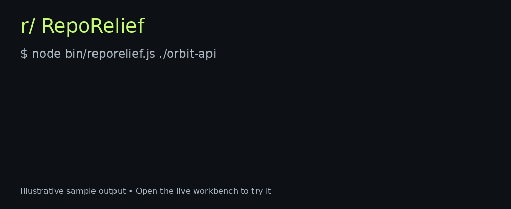

<div align="center">

# RepoRelief

### Less upkeep. More shipping.

Turn repository maintenance into an evidence-based action plan.

[](https://github.com/brunnojob/reporelief/actions/workflows/ci.yml)
[](https://github.com/brunnojob/reporelief/actions/workflows/pages.yml)

[](LICENSE)
[](https://buymeacoffee.com/brunnodev)

[**Open the workbench**](https://brunnojob.github.io/reporelief/) · [Quick start](#quick-start) · [Contribute](CONTRIBUTING.md)



</div>

## The work everyone postpones

Documentation drifts. Tests get deferred. Legacy modules grow. Reviewing a change starts with reconstructing context.

RepoRelief turns visible repository signals into a prioritized queue with file-level evidence and a practical next step. Use the same dependency-free engine in your terminal or browser.

| Friction | What RepoRelief does |
| --- | --- |
| “I'll write the docs later” | Finds missing setup, usage and testing sections |
| “Where should I add tests?” | Flags modules without matching test filenames |
| “I'm afraid to touch this file” | Highlights large modules and suggests characterization tests |
| “What do I review?” | Builds a change checklist and lists matching tests from a Git diff |
| “Checks only run on my machine” | Detects missing GitHub Actions workflows |
| “Can we reuse this?” | Detects a missing root license |

## Quick start

Requires Node.js 22 or later and Git. No npm installation, API key or account required.

```bash
git clone https://github.com/brunnojob/reporelief.git
cd reporelief
node bin/reporelief.js /path/to/your/project
```

```bash
# Structured output for your own tools
node bin/reporelief.js /path/to/project --json

# Save an actionable Markdown plan
node bin/reporelief.js /path/to/project > maintenance-plan.md

# Compare committed changes with a base revision (run inside the tool checkout)
node bin/reporelief.js /path/to/project --changed main
```

`--changed` uses `git diff BASE...HEAD`. It requires the base revision in the target repository and excludes uncommitted changes. A comparison against the current branch produces no changed files.

<details>
<summary><strong>Explore an example finding</strong></summary>

```json
{
  "id": "docs.testing",
  "priority": "medium",
  "title": "Document testing",
  "evidence": ["README.md"],
  "action": "Add a testing section with commands verified by a maintainer."
}
```

Every finding provides a rule identifier, priority, evidence and a suggested action. There is no invented quality score.

</details>

<details>
<summary><strong>Use it in your GitHub Actions pipeline</strong></summary>

After checking out your project and setting up Node.js 22:

```yaml
- uses: actions/checkout@v4
  with:
    repository: brunnojob/reporelief
    path: .tools/reporelief
- name: Generate maintenance plan
  run: node .tools/reporelief/bin/reporelief.js . > maintenance-plan.md
- uses: actions/upload-artifact@v4
  with:
    name: maintenance-plan
    path: maintenance-plan.md
```

For reproducible integrations, pin the tool checkout to a reviewed commit SHA. Keep the tool checkout outside your scan root where practical; otherwise its files are included in the audit. Findings are advisory and do not fail CI.

</details>

## Browser workbench

[Launch the live workbench](https://brunnojob.github.io/reporelief/). Run the labeled sample or select a local folder, filter by priority and export the plan. Selected files are processed in the browser without uploading them. Directory selection works in browsers supporting `webkitdirectory`.

GitHub READMEs do not run JavaScript or arbitrary iframe embeds, so the README embeds the animated preview and live workflow badges; the interactive tool lives on Pages.

## Honest boundaries

This release uses static text and filename heuristics. It does **not** measure test coverage, prove correctness, generate tests, build a semantic call graph or rewrite source code. README keywords and test-name matches can produce false positives or miss unconventional structures.

The CLI skips symlinks, environment files, common generated directories, binary files and files over 512 KB. Scans are capped at 20 MB of text and 10,000 files. Only scanned files contribute to findings. Exclusions are not a secret scanner; inspect exports before sharing them.

## Development and testing

```bash
npm test
npm run check
npm run audit
```

Node's built-in test runner covers missing repository essentials, matching tests, path normalization and legacy-module signals. CI runs Node.js 22 and 24 on Linux and Windows and checks that the browser and CLI engines stay identical.

Contributions are welcome: see [CONTRIBUTING.md](CONTRIBUTING.md). Suggested starter tasks include Python test-name conventions, more language fixtures and accessibility improvements. Feature requests should include a concrete input and expected finding.

## Support the project

If RepoRelief saves you maintenance time, [buy brunnodev a coffee](https://buymeacoffee.com/brunnodev).

MIT · Built by [brunnodev.store](https://brunnodev.store)
